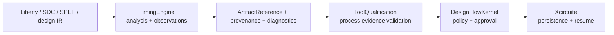

# TimingEngine Design

## Purpose

TimingEngine owns canonical timing data, MMMC static timing analysis, signal-integrity analysis, retained observations and independent-oracle correlation.

## Responsibility boundary

TimingEngine can report that a retained corpus or oracle comparison agrees for a declared scope. It does not decide that a tool is production-qualified and does not approve a release. `ToolQualification` validates raw process evidence. `DesignFlowKernel` applies flow policy and approval. `Xcircuite` owns concrete workspace and run persistence.

## Trust model

The following states are independent:

| State | Owner | Meaning |
|---|---|---|
| Execution completed | TimingEngine backend | A typed analysis result was produced |
| Corpus replay valid | TimingEngine | Retained expected observations were reproduced |
| Oracle correlation passed | TimingEngine verifier | Raw native and oracle outputs agree within a declared tolerance |
| Process evidence accepted | ToolQualification | Raw evidence was reconstructed and validated for a process scope |
| Flow approved | DesignFlowKernel | Policy and human approval permit promotion |

Persisted decision fields are not trusted. `TimingEvidenceAssessment.outcome` is derived from findings. External correlation is accepted only after workspace containment, digest, byte-count, producer, invocation, input and metric reconstruction checks.

The external oracle consumer uses the public `STAExecutionResult` decoder as its
schema authority. It accepts the current STA schema and rejects obsolete or
unsupported schemas as `external_oracle_output_invalid`; it does not maintain a
separate version literal. Run identity is checked after canonical decoding.
The real process tests in [CorpusTests](Tests/TimingEngineTests/CorpusTests.swift)
verify current-schema consumption, run mismatch, and v1/v2 rejection through
retained JSON bytes emitted by `/bin/cat`.

The OpenSTA execution boundary does not trust a caller-declared tool identity. The adapter resolves the executable, validates that it is a regular executable file, measures its SHA-256, and verifies its reported version. It then creates one immutable, create-only run workspace under the caller's declared workspace root, copies the executable and all input artifacts into that workspace, and invokes only those snapshots. Executable and input bytes are verified again after analysis. The observed digest is stored as the supporting tool producer build so ToolQualification can bind the result to its independently verified `binaryDigest`.

The checked-in Sky130A directory is an input manifest, not a foundry corpus. Its required Liberty file is deliberately external; absence or digest drift is reported as incomplete PDK evidence. No checked-in decision artifact may convert that missing input into qualification.

## Artifact boundary

Correlation artifacts keep location-independent `ArtifactReference` identity separate from workspace-root `ArtifactAvailability`. The caller supplies one explicit workspace root, and bounded `ArtifactRootCapability` sessions reject root mismatch, symlink traversal, digest/size drift, budget exhaustion, and close failure. OpenSTA execution artifacts are retained beneath `.timingengine/runs/<run-id>/opensta/`; an existing run workspace is never replaced, and run IDs must be stable path-safe identities rather than sanitized aliases. Native and oracle outputs must retain the same input artifact identities and an independent oracle executable identity. A declared executable version without a matching measured digest is not production evidence.

## Dependency direction

[TimingCore](Sources/TimingCore/DESIGN.md) owns source-preserving strict Liberty
characterization and checked load/slew evaluation consumed by CTS. Ordinary STA
parsing cannot establish that strict source-admission contract.

[TimingCore cap-load reduction](Sources/TimingCore/ParasiticReduction/DESIGN.md)
owns explicit equipotential approximation over preserved source inventory. Native
STA and [SignalIntegrityEngine](Sources/SignalIntegrityEngine/DESIGN.md) retain its
loss evidence. D_NET inventory is not an effective load. Native algorithm identity
2.0.0 and request/result v3 prevent old result-scope reuse; distributed post-layout
signoff remains outside this approximate cap-load scope.

Native STA process/corner intake is owned by
[STAEngine](Sources/STAEngine/DESIGN.md) and its
[ProcessCorners component](Sources/STAEngine/ProcessCorners/DESIGN.md).
Every completed native STA report retains the validated process identity and
exact PVT/corner-to-Liberty selection. Input bindings preserve materialization;
the selection preserves location-independent identity. Missing or contradictory
process/corner inputs block before report publication. No default corner is
invented and libraries from different corners are never merged for analysis.

TimingEngine depends on the portable `CircuiteFoundation` contracts and opts into Foundation, Crypto, and FileSystem products only in targets that perform serialization, digesting, or local access. It does not import Xcircuite or circuit-studio. ToolQualification remains a downstream trust consumer and is not a dependency of TimingCore.

## Non-responsibilities

- Parasitic extraction
- Placement or routing mutation
- Tool self-qualification
- Flow approval, waiver, release or resume policy
- Concrete `.xcircuite` storage

The scalar correlation analyzer consumes the same published cap-load reduction contract through TimingParasiticReducing and identifies the changed load semantics as `timing.reference.scalar-v2`. Its numerical correlation remains local model evidence, not distributed RC or process-qualified signoff.

## Exact PDK Identity Dependency Adoption

[Package.swift](Package.swift) owns the exact revisions consumed by this package.
This adoption consumes the updated PDKCore product directly or transitively.
[Checked PDK identity values](../PDKKit/Sources/PDKCore/Identity/DESIGN.md)
and their immutable schema-2 representation remain owned by the lower contract.
Manifest discovery/exact loading remains owned by
[PDKDiscovery](../PDKKit/Sources/PDKDiscovery/ManifestLoading/DESIGN.md).
Transitive revisions must agree with the composing Xcircuite graph without overrides.
This dependency change preserves this package's domain implementation; lower
behavioral evidence and host identity/provenance tests establish the consumed
contract, not process qualification or unexecuted domain test coverage.
