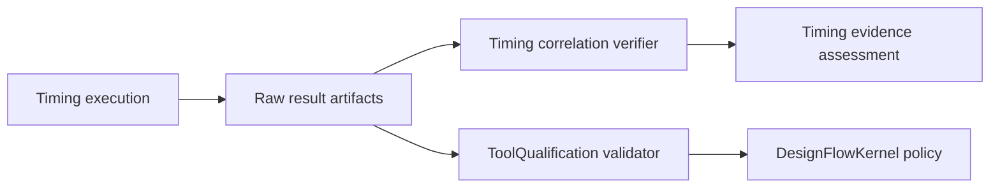

# TimingEngine Implementation Plan

## Completed foundation

1. Liberty, SDC, SDF and SPEF parsing
2. Canonical timing graph and constraints
3. MMMC setup/hold analysis
4. Coupling-aware signal integrity
5. Structured diagnostics and Foundation-native results
6. Retained corpus replay and external OpenSTA execution
7. Workspace-bound raw correlation reconstruction
8. Non-authoritative evidence assessment

## Trust integration

The next prepared native input/configuration implementation follows
[PreparedExecution](Sources/STAEngine/PreparedExecution/DESIGN.md), using the optional
[profile inspection module](Sources/TimingPDKProfileInspection/DESIGN.md) for retained
Liberty grammar owners. Existing codec and strict corner evidence is reused; the
host owns final adoption and resume validation. These connections remain pending.

TimingEngine produces exact raw analysis and correlation artifacts with location-independent identity and execution-scoped availability. Host integration presents those artifacts to ToolQualification for process-evidence reconstruction; TimingCore does not reverse-depend on the trust package. DesignFlowKernel applies policy and approval after ToolQualification validation.

## Completion gates

- Public APIs remain protocol-first and Sendable.
- Unsupported semantics produce structured blocked results.
- Native and external backends produce the same domain result schema.
- Correlation artifacts use bounded access under one declared workspace root capability.
- Persisted verdicts are recomputed from retained bytes.
- No TimingEngine type claims production qualification.
- Xcircuite can execute and persist timing stages without importing UI state into this package.
