# Timing CLI

## Purpose and Scope

Own the standalone executable composition and argument admission. Parent:
[TimingEngine](../../DESIGN.md). No children. This change owns strict STA request
execution; existing parse, ordinary STA, SI, corpus and oracle commands retain
their current contracts.

## Responsibilities and Boundaries

The CLI admits explicit transport and resource inputs, invokes public domain
operations, emits results and stores checked reports. It does not infer supplies,
cell or RC corners, timing applicability, source laws, qualifications or approval.

## Related Designs

| Design | Relationship | Contract Used | Summary | Cautions |
|---|---|---|---|---|
| [Package](../../DESIGN.md) | parent | Exact dependency and trust boundaries | Executable composition | Local execution is not qualification |
| [PreparedExecution](../STAEngine/PreparedExecution/DESIGN.md) | depends on | STARequest, prepared source owner and limits | Exact inputs and source accounting | One retained accountant across prepare/execute/replay |
| [PathAnalysis](../STAEngine/NativeExecution/PathAnalysis/DESIGN.md) | depends on | Complete strict receipts and validation | Native source meaning | JSON is untrusted transport |
| [TimingCore](../TimingCore/DESIGN.md) | depends on | Artifact reader/store and canonical values | Exact input and immutable report I/O | No second source interpretation |

## Architecture

```mermaid
flowchart LR
  Args[Explicit request and resource options] --> Read[Bounded regular-file snapshot]
  Read --> Decode[Canonical STARequest decoder]
  Decode --> Prepare[Public prepare]
  Prepare --> Execute[Public execute without store]
  Execute --> Validate[Same prepared source validation]
  Validate --> Store[Public immutable artifact store]
  Store --> Emit[Canonical execution result]
```

## Contracts and Invariants

`run-sta --request` consumes the existing schema-4 STARequest without rebuilding
artifact descriptors, identities or availability. It requires
`requireStrictSourceEvidence == true`. Ordinary file-argument STA retains its
existing defaults and execution path. Request mode accepts only its declared
option/value pairs, rejecting unknown, duplicate, missing and mixed file arguments.
`--workspace-root` and a positive host-addressable `--maximum-request-bytes` are
required. `--out` is an optional contained artifact directory, as in ordinary STA.

Request file admission uses a nonblocking, no-follow owned descriptor, rejects
nonregular files and oversized input before materialization, reads at most the
admitted size plus one detection byte, and refuses length drift. Close failure is
observable, including a primary failure followed by close failure. JSON decoding
uses the canonical request owner; it does not grant source authority.

Resource options belong only to request mode. Native limits use the existing
public defaults for omitted fields. Source storage/work/duration overrides form
one optional complete group; absent overrides use the original source defaults.
All counts are positive with checked host conversions; duration is a positive
integer number of seconds representable as Int64 nanoseconds. No implicit budget increase or reset occurs. Source
nesting remains the native grammar policy of 64. Original whole Sky130 TT intake
can select maximum-input-bytes 33554432 and the already verified source group
1073741824 bytes / 1000000000 work / 90 seconds; these are explicit caller inputs,
not a new default or a guarantee that every future graph fits those bounds.

The prepared owner, exact reader and single source accountant remain alive through
execution and bounded source replay. The execution engine has no artifact store.
Only successful source validation admits report storage. Result reconstruction
uses the native result's exact payload, inputs, diagnostics and provenance plus
the actual returned report binding. A saved payload/result is still untrusted;
fresh preparation and public validation are required on replay.

## State, Ownership, and Lifecycle

All mutable state is invocation-local. The request descriptor has one FileHandle
owner, closed on every path. Prepared/source owners retain their original limits,
deadline and leases; the CLI neither copies their accounting into a fresh ledger
nor substitutes a second source evaluation. Store publication follows validation.

## Failure, Concurrency, and Constraints

Option, transport, canonical decode, preparation, numerical, source-validation,
resource and storage failures remain observable and exit nonzero. No source
failure publishes a successful report. The existing CLI error envelope retains its
current schema and includes the original preparation/execution case and cause
reason in its message. Different invocations use caller-owned run identities/directories;
immutable store collision rules remain authoritative.

## Verification and Change Impact

[Strict CLI tests](../../Tests/TimingEngineTests/STAStrictRequestCLITests.swift)
execute the actual binary with two exact corners, all five check kinds, explicit
four-PG conditions, propagated clocks and distributed RC. They compare API/CLI
source receipts, decode the saved payload/result, and validate against a fresh
prepared owner. Missing/tampered supplies, source bytes, strict flag and resource
admission refuse without publication. Ordinary STA process regressions cover the
unchanged file route; unrelated external-oracle startup timing is separate.
